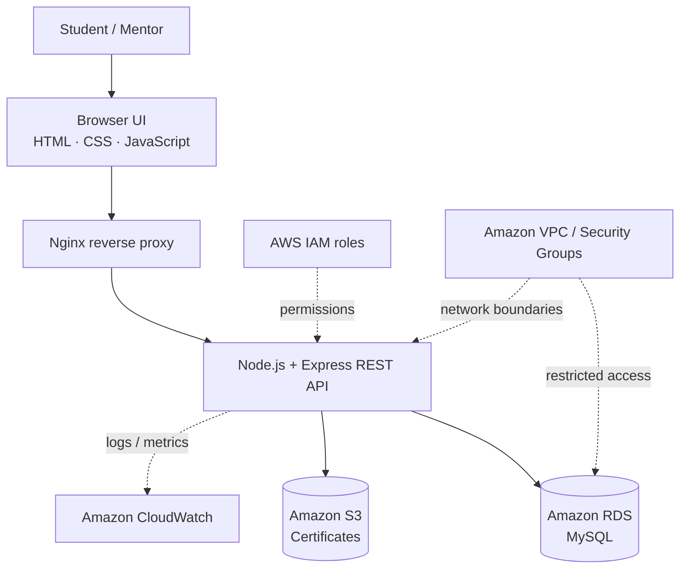

# Smart Portfolio – Architecture Notes

This document summarizes the architecture described in the APSSDC internship project report for **Smart Portfolio on Student Performance and Feedback**.

## 1. High-level flow

The report describes the frontend and Express backend hosted on an Ubuntu-based Amazon EC2 instance. Nginx forwards incoming web requests to the backend application (the report specifies port 3000).

## 2. Application layers

### Presentation layer
- HTML5, CSS3, and JavaScript
- Portfolio creation and display
- Semester marks entry and viewing
- Certificate upload interface
- Mentor feedback viewer
- Responsive layouts

### Application logic layer
- Node.js and Express.js
- REST API routing
- JWT-based login and role handling for students and admins/mentors
- Portfolio create, read, update, and delete operations
- Multer for incoming file uploads
- AWS SDK integration for S3
- Input validation and sanitization

### Data and file storage layer
- Amazon RDS for MySQL records
- Amazon S3 for certificate objects
- Sequelize ORM for model definitions and database access

## 3. Logical data entities

| Entity | Fields listed or implied by the report |
|---|---|
| users | id, name, email, password, role |
| portfolios | id, user_id, description, created_at |
| marks | id, user_id, semester, subject, marks |
| certificates | id, user_id, s3_url, uploaded_at |
| feedback | id, user_id, mentor, comment, given_at |

This is a report-level summary, not a verified SQL schema. The actual source and migrations should be checked before implementing or documenting exact constraints and relationships.

## 4. AWS components

| AWS component | Purpose in the report |
|---|---|
| EC2 | Hosts the frontend/backend application on Ubuntu |
| RDS (MySQL) | Stores user, portfolio, marks, and feedback records |
| S3 | Stores uploaded certificate files |
| IAM | Controls application permissions to AWS resources |
| VPC | Isolates cloud networking |
| Security Groups | Restrict inbound and database connectivity |
| CloudWatch | Monitors instance health, resource usage, and application logs |

The report also mentions Nginx as a reverse proxy and PM2 to keep the Node.js process running.

## 5. Certificate upload flow

1. A student selects a PDF or image certificate in the browser.
2. The request reaches the Express API.
3. Multer handles the incoming file.
4. The backend uses the AWS SDK to store the file in S3.
5. Certificate metadata and its storage reference are recorded in MySQL.
6. The report describes authenticated, signed URLs for controlled viewing.

## 6. Deployment outline from the report

1. Launch an Ubuntu-based EC2 instance.
2. Install and configure Node.js and Nginx.
3. Deploy the application code to the instance.
4. Configure Nginx to proxy requests to the Express server on port 3000.
5. Configure RDS MySQL and restrict database access to the application environment.
6. Configure an S3 bucket with public access blocked and suitable IAM permissions.
7. Use PM2 to manage the Node.js process.
8. Use CloudWatch for monitoring and logs.

Exact commands, environment variables, IAM policies, ports, and configuration files must be taken from the actual project source and AWS setup; they are not included in the report.

## 7. Verification checklist before public release

- [ ] Add the original application source code.
- [ ] Remove credentials, tokens, private keys, and real student data.
- [ ] Verify authentication and authorization for every protected API.
- [ ] Verify file type and size validation for uploads.
- [ ] Confirm S3 buckets are not publicly readable.
- [ ] Confirm database access is limited to trusted application resources.
- [ ] Add sanitized environment-variable examples.
- [ ] Add exact local installation and run instructions.
- [ ] Add screenshots that do not expose personal or student information.
- [ ] Test the documented deployment procedure.
